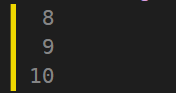
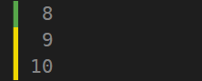

# Track Changes

**English** | [简体中文](README.zh-CN.md)

Visual Studio's **Track Changes** for VS Code: a colored bar next to the line numbers marks every line you have changed since the file was opened.

| Color | Meaning |
| --- | --- |
| 🟨 Yellow | Changed, not saved yet |
| 🟩 Green | Changed and saved |
| 🟦 Blue, hatched | Undoing a saved change brought the line back to its content from when the file was opened; not saved yet |

| Unsaved changes | Saved change, then a new edit |
| --- | --- |
|  |  |

As in Visual Studio, the marks come from **your edits and the undo history**, not from comparing file contents (and not from Git):

- Every edit marks the lines it touches. Type a character and delete it with Backspace: the text is unchanged, but the line stays yellow.
- Pressing Enter marks two lines: the line the cursor was on and the new line.
- Undo restores the marks from before the edit: press Enter, then Ctrl+Z, and nothing is left.
- After undoing a **saved** change, the line differs from the file on disk:
  - if it is back to its content from when the file was opened, it is blue and hatched, and has no mark once saved (Enter → save → Ctrl+Z → save leaves nothing);
  - if it is back to an intermediate state, it is yellow, and green once saved (Enter → save → Enter → save → Ctrl+Z: the line above is green, the one below yellow).
- Redo (Ctrl+Y) turns the line green again.
- Tracking starts fresh each time a file is opened, and is cleared when it is closed.

## Commands

| Command | Description | Shortcut |
| --- | --- | --- |
| `Track Changes: Toggle Track Changes` | Show or hide the marks | |
| `Track Changes: Reset Tracking for Current File` | Clear all marks in the current file, as if it had just been opened | |
| `Track Changes: Reset Tracking for All Files` | The same, for every open file | |
| `Track Changes: Go to Next Change` | Jump to the next changed block | `Ctrl+Alt+↓` / `Cmd+Alt+↓` |
| `Track Changes: Go to Previous Change` | Jump to the previous changed block | `Ctrl+Alt+↑` / `Cmd+Alt+↑` |

## Settings

| Setting | Default | Description |
| --- | --- | --- |
| `trackChanges.enabled` | `true` | Show the marks |
| `trackChanges.unsavedColor` | `#EFD700` | Color for unsaved changes |
| `trackChanges.savedColor` | `#57A64A` | Color for saved changes |
| `trackChanges.revertedColor` | `#3E8FD8` | Color for lines undone back to their original content (hatched) |
| `trackChanges.markerWidth` | `3` | Width of the bar, 1–16, about one pixel per unit |
| `trackChanges.showInOverviewRuler` | `true` | Also show the marks in the scrollbar |
| `trackChanges.maxFileLines` | `100000` | Files with more lines are not tracked |
| `trackChanges.debounceMs` | `0` | Delay before the marks refresh after an edit, in milliseconds; 0 is immediate, raise it only if very large files feel slow |
| `trackChanges.language` | `auto` | Language of the extension's messages: `auto` (follow VS Code), `en`, `zh-cn` |

## Language

The extension is available in English and Simplified Chinese, and follows the VS Code display language by default (`Configure Display Language` in the Command Palette).

- VS Code picks the language of command names, setting descriptions and the extension description from the display language; an extension cannot change them on its own.
- The messages the extension shows while running (such as status bar messages) can be set to English or Chinese with `trackChanges.language`.

## Notes

- The marks are drawn where gutter icons go. If VS Code's own Git change marks (`scm.diffDecorations`) are on, both show side by side; set it to `"overview"` or `"none"` to avoid the duplication.
- Undo history from before the extension started cannot be matched up; undoing those changes marks the lines yellow, like a normal edit.
- When lines are deleted, the mark goes on the line after the deleted ones, as in Visual Studio.

## Development

```bash
npm install
npm test          # compile and run the unit tests
```

Open this folder in VS Code and press `F5` to start an Extension Development Host. To package:

```bash
npx @vscode/vsce package --skip-license
```
