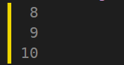
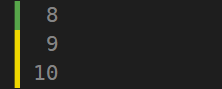

# Track Changes

[English](README.md) | **简体中文**

在 VS Code 中仿照 Visual Studio 的 **Track Changes**（跟踪更改）功能：在编辑器左侧行号旁显示一条彩色竖条，标出本次打开文件以来修改过的行。

| 颜色 | 含义 |
| --- | --- |
| 🟨 黄色 | 已修改，尚未保存 |
| 🟩 绿色 | 已修改，并且已保存 |
| 🟦 蓝色斜纹 | 撤销已保存的修改后，该行回到了打开文件时的内容，但还没保存 |

| 未保存的修改 | 保存后又有新的修改 |
| --- | --- |
|  |  |

与 Visual Studio 一样，标记来自**编辑操作和撤销历史**，而不是比较文件内容（与 Git 无关）：

- 每次编辑都会标记它碰到的行。输入一个字符再用 Backspace 删掉，内容虽然没变，这一行仍然是黄色。
- 按回车会标记光标原来所在的行和新产生的行（两行）。
- 撤销会恢复编辑之前的标记：按回车再 Ctrl+Z，什么都不留下。
- 撤销**已保存**的修改后，该行和磁盘内容不同：
  - 如果一路撤销回到了打开文件时的内容，显示蓝色斜纹，再保存后不留标记（例如：回车 → 保存 → Ctrl+Z → 保存，最后什么都没有）；
  - 如果只撤销到中间某个状态，显示黄色，再保存后变绿（例如：回车 → 保存 → 回车 → 保存 → Ctrl+Z，上一行绿、下一行黄）。
- 重做（Ctrl+Y）恢复成绿色。
- 每次打开文件都从零开始，关闭文件后记录清空。

## 命令

| 命令 | 说明 | 快捷键 |
| --- | --- | --- |
| `跟踪更改: 开启/关闭跟踪更改` | 开/关显示 | |
| `跟踪更改: 重置当前文件的跟踪` | 清除当前文件的所有标记，相当于重新打开 | |
| `跟踪更改: 重置所有文件的跟踪` | 对所有打开的文件执行上述操作 | |
| `跟踪更改: 转到下一处修改` | 跳到下一处修改 | `Ctrl+Alt+↓` / `Cmd+Alt+↓` |
| `跟踪更改: 转到上一处修改` | 跳到上一处修改 | `Ctrl+Alt+↑` / `Cmd+Alt+↑` |

VS Code 为英文界面时，命令显示为英文（如 `Track Changes: Toggle Track Changes`）。

## 设置

| 设置 | 默认值 | 说明 |
| --- | --- | --- |
| `trackChanges.enabled` | `true` | 是否显示标记 |
| `trackChanges.unsavedColor` | `#EFD700` | 未保存修改的颜色 |
| `trackChanges.savedColor` | `#57A64A` | 已保存修改的颜色 |
| `trackChanges.revertedColor` | `#3E8FD8` | 撤销回原始内容（斜纹）的颜色 |
| `trackChanges.markerWidth` | `3` | 标记竖条的宽度，1–16，大约每单位 1 像素 |
| `trackChanges.showInOverviewRuler` | `true` | 同时在滚动条概览中显示 |
| `trackChanges.maxFileLines` | `100000` | 超过此行数的文件不跟踪 |
| `trackChanges.debounceMs` | `0` | 编辑后延迟多久刷新标记（毫秒）；0 为立即刷新，超大文件卡顿时再调大 |
| `trackChanges.language` | `auto` | 插件提示信息的语言：`auto`（跟随 VS Code）、`en`、`zh-cn` |

## 语言

插件支持中文和英文，默认跟随 VS Code 的显示语言（命令面板中的 `Configure Display Language`）。

- 命令名称、设置说明和插件描述由 VS Code 根据显示语言选择，插件无法单独更改。
- 插件运行时显示的提示（例如状态栏消息）可以用 `trackChanges.language` 单独指定为中文或英文。

## 说明

- 标记画在 gutter 图标位置。如果同时启用了 VS Code 自带的 Git 修改标记（`scm.diffDecorations`），两者会并排显示；不想重复可以把它设为 `"overview"` 或 `"none"`。
- 插件启动之前就已有的撤销历史无法对应，撤销这些修改时按普通编辑显示为黄色。
- 删除行时，标记落在删除位置的下一行（与 Visual Studio 一致）。

## 开发

```bash
npm install
npm test          # 编译并运行单元测试
```

在 VS Code 中打开本目录，按 `F5` 启动扩展开发宿主进行调试。打包：

```bash
npx @vscode/vsce package --skip-license
```
